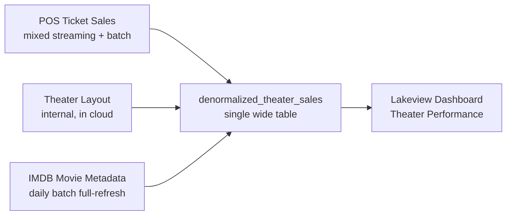
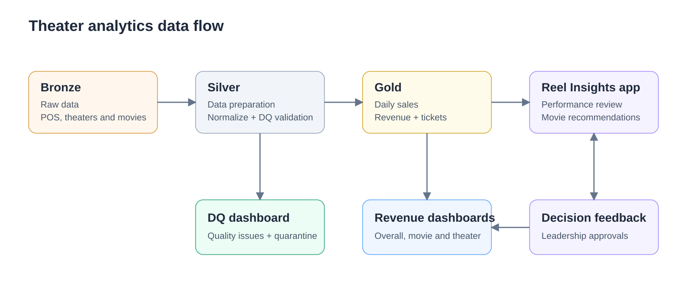

# FDE Interview Packet: Theater Sales Review

A Declarative Automation Bundle that provisions an end-to-end theater sales analytics environment for the FDE Build, Demo & Delivery interview. The candidate receives the as-is implementation as a starting point and builds a real POC of an architectural component that solves a business problem as defined in their scenario prompt.

**Ready to deploy?** Jump to **[SETUP.md](SETUP.md)**.

## As-Is Architecture

The scaffold is the customer's existing implementation — a working end-to-end pipeline you can explore before proposing changes.

| Asset | Description |
|-------|-------------|
| **3 source tables** | `theater_layout` (clean), `imdb_movie_metadata` (clean), `pos_ticket_sales` (data-quality issues seeded per POS source) |
| **1 denormalized table** | `denormalized_theater_sales` — naive inner-join that silently drops orphan rows |
| **4 jobs** | `seed_theater_data` (ingest), `build_denormalized_theater_sales` (existing transform), `build_silver_theater_data` (Silver notebooks), and `build_gold_theater_data` (daily Gold aggregation after Silver) |
| **3 Lakeview dashboards** | `Theater Performance` (legacy sales KPIs), `Theater Data Quality` (Silver and quarantine), and `Theater Revenue Insights` (Gold daily sales) |
| **1 Databricks App** | `reel-insights-app` — Gold sales KPIs, movie recommendations, and leadership-approved decision feedback |



For the editable diagram, see [`reference/fde_design_and_build_asis_architecture.excalidraw`](reference/fde_design_and_build_asis_architecture.excalidraw) or open it directly in [Excalidraw](https://excalidraw.com/#json=XoIQCpDoQJLFVXLSI3FAy,sLHBahpjIT5TF7fXiYB8bg).

## Enhanced Data Flow

Bronze -> Silver with DQ validation -> Gold -> dashboards and the app, with
leadership decision feedback.

[View the full-size diagram](reference/theater_enhancements_dataflow.svg) or use
the [editable Mermaid source](reference/theater_enhancements_dataflow.md).



## What the Customer Is Asking For

The customer believes their problem is the dashboard. **Your job is to read between the lines** — the gaps in this scaffold are the gaps your proposed architecture needs to address. See the candidate prompt for details.

## Fast Iteration

Not every change requires a full cold start (`deploy` → `seed_theater_data` → `build_denormalized_theater_sales`).

Run these commands from the repository root. Replace `my-profile` with your Databricks CLI profile name. `--force` is not needed for a normal deploy; it overrides Git-branch validation.

Use `--params` to select the catalog/schema for each job run without redeploying.
`--var` sets bundle configuration (including deployed job defaults), not per-run
job parameter overrides. The commands below explicitly use `theater_analytics.bronze`.
Seeding overwrites all three source tables.

| Tier | When to use | Commands |
|------|-------------|----------|
| **Dashboard only** | Editing `src/dashboard/theater_performance.lvdash.json` | `databricks bundle deploy --target dev --profile my-profile`. Skip both jobs. |
| **Transform only** | Source tables exist (Silver job requires `theater_analytics.bronze`); you changed a Silver notebook or the denormalized transform | `databricks bundle deploy --target dev --profile my-profile`<br>`databricks bundle run --target dev --profile my-profile build_silver_theater_data`<br>`databricks bundle run --target dev --profile my-profile build_denormalized_theater_sales --params="catalog=theater_analytics,schema=bronze"` |
| **Source data** | You changed an ingest script | `databricks bundle deploy --target dev --profile my-profile`<br>`databricks bundle run --target dev --profile my-profile seed_theater_data --params="catalog=theater_analytics,schema=bronze"`<br>`databricks bundle run --target dev --profile my-profile build_denormalized_theater_sales --params="catalog=theater_analytics,schema=bronze"` |
| **App** | Iterating on the Databricks App; Gold tables and grants already exist | `databricks bundle deploy --target dev --profile my-profile --select apps.reel_insights_app`<br>`databricks bundle run --target dev --profile my-profile reel_insights_app` |
| **Gold/app data refresh** | Bronze exists in `theater_analytics.bronze`; refresh the app's serving data | `databricks bundle deploy --target dev --profile my-profile`<br>`databricks bundle run --target dev --profile my-profile build_silver_theater_data`<br>`databricks bundle run --target dev --profile my-profile build_gold_theater_data` |
| **Legacy dashboard cold start** | Initialize the original Bronze-based dashboard | Deploy the bundle, then run `seed_theater_data` followed by `build_denormalized_theater_sales` (same three commands as **Source data**). For the Gold app, follow [SETUP.md section 5](SETUP.md#5-deploy-and-start-the-provided-application), including feedback/grants. |

The Silver job currently has fixed paths: it reads `theater_analytics.bronze`
and writes `theater_analytics.silver`, so it does not accept catalog/schema
overrides. The denormalized transform reads and writes the selected schema;
it is not yet a Silver-to-Gold job. Per-run overrides do not change app or
dashboard configuration.
The **Source data** and **Transform only** commands above refresh the legacy
dashboard, not Gold. Follow them with the **Gold/app data refresh** commands
when the app must reflect those changes.

### Run the Silver job

After Bronze seeding completes, run the three source Silver notebooks in parallel,
followed automatically by the combined Silver notebook:

```powershell
databricks bundle run --target dev --profile my-profile build_silver_theater_data
```

If you changed the Silver notebooks or job definition, deploy the bundle first.
No `--params` or `--var` flags are needed for this job's fixed Bronze-to-Silver paths.

### Combined Silver snapshot for Gold

After all three Silver loads succeed, the Silver job automatically runs
[`build_silver_denormalized_theater_sales.py`](src/notebooks/build_silver_denormalized_theater_sales.py)
as a notebook. It incrementally merges
`theater_analytics.silver.denormalized_theater_sales` for downstream Gold datasets.
Deploy the updated bundle before running the Silver job to include this fourth task.

POS is the driving table, with LEFT JOINs to theater/screen layout and IMDb.
Every `(transaction_id, pos_source)` is retained, including unmatched references.
Missing reference text becomes `Unknown`; numeric, date, timestamp, and Boolean
nulls retain their types. Both manager email columns, all POS fields, reference
ingestion metadata, `metascore`, and `screen_number` are included.
`gross_revenue` aliases the existing decimal `revenue` for compatibility.
`has_layout_match` and `has_movie_match` expose reference gaps without rewriting
POS quality flags. Missing screen matches also yield `Unknown` managers;
manager columns alone do not enforce RLS.

Before enrichment, POS rows replay from each source's latest target ingestion
date, inclusive. New sources and missing/empty targets load in full. MERGE uses
`(transaction_id, pos_source)` and updates only for a newer POS ingestion timestamp
and a different source-row hash, matching Silver POS. The Delta target is clustered
by `(transaction_id, ingestion_date)`, including existing targets.
Reference-only corrections, earlier late arrivals, and source deletions require
a separate refresh/backfill; equal-timestamp replay does not update enrichment.
Duplicate/missing candidate or reference keys fail before merging, and target
keys are validated before and after the load.
Run without concurrent Silver writers. Quarantine is not included, and the
existing Bronze-based transform/dashboard are unchanged. The app reads the
separate Gold daily-sales table described below.

### Gold daily theater sales

Run [`build_gold_theater_daily_sales.py`](src/notebooks/build_gold_theater_daily_sales.py)
after the three source Silver loads complete. It full-refreshes
`theater_analytics.gold.theater_daily_sales` directly from Silver POS, not the
combined Silver table. The separate `build_gold_theater_data` job runs this
notebook on serverless compute, with one concurrent run allowed.

Deploy, then run Gold after Silver succeeds:

```powershell
databricks bundle deploy --target dev --profile my-profile
databricks bundle run --target dev --profile my-profile build_gold_theater_data
```

The Gold job does not rerun or automatically trigger Silver. Table paths are fixed;
no catalog/schema overrides are needed. Do not run Gold while Silver is writing.

The grain is `(theater_id, screen_id, movie_id, format, show_date)`, where
`show_date = DATE(showtime)` in UTC. Revenue and seats sold are summed across
transactions/POS sources **before** LEFT JOINing Silver layout and IMDb.
Reference attributes include manager and zone-manager emails; missing text
becomes `Unknown` while other types remain nullable. Match flags expose gaps.
Transaction-level fields are excluded. Null showtimes remain in null-date groups;
flagged Silver rows remain included, and quarantine is not read. Duplicate source
keys fail before writing. Run without concurrent Silver writers.
Gold `open_time`/`close_time` are native `TIME(0)` columns, with nulls for unmatched
references and `00:00:00` for midnight. Invalid time strings fail the load.
Use TIME-capable compute (Databricks Runtime 18 LTS+ or supported serverless).
Existing Gold targets have the Delta `timeType` feature enabled before overwrite;
downstream readers must also support TIME.

### Gold app and decision feedback

The Gold dashboard [`Theater_Revenue_Insights.lvdash.json`](src/dashboard/Theater_Revenue_Insights.lvdash.json)
is registered as `dashboards.theater_revenue_insights`. After building Gold,
deploy just this dashboard with:

```powershell
databricks bundle deploy --target dev --profile my-profile --select dashboards.theater_revenue_insights
```

Its **Approved decisions** page reads the Gold feedback table, with separate
approval-date, action, and theater-scope filters. It displays the audit ID,
movie/action, approver, rationale, reviewed sales period, and recorded metric
evidence. Create `decision_feedback` first using the owner-run notebook below;
the dashboard query identity also needs SELECT on that table. Sales-table row
filters do not secure feedback records; grant audit access only to intended viewers
or the intended dashboard execution identity.

The **By Movie** page includes a Movie filter, a distinct-known-movie-ID count,
and a **Movie Theaters and States** table with one row per movie ID, theater
(name and ID), and state. These share the sales dataset and respect all page
filters and the Gold row filter under the dashboard execution identity. "Played"
means present in Gold sales for the selected dates, not a live screening schedule.
The page no longer includes the Total Revenue/Showings KPI cards or Movie
Placement Matrix; revenue and showing measures remain in the performance detail.

The existing Gradio app now reads Gold daily sales for the latest seven calendar
days ending at the maximum `show_date` visible to the signed-in user under Gold
row-level security, with optional state and theater filters. State selection
limits the theater choices; a previously selected theater outside the state
resets to all theaters in that state. All KPIs, chart data, and recommendations
use both filters. The seven-day period stays anchored to the user's latest
visible show date, not the selected state's latest sale.
The daily revenue chart uses Gold `show_date` (displayed as `YYYY-MM-DD`) and
`SUM(revenue)` per date; it does not use ingestion timestamps.
KPIs show revenue, tickets, active theaters, and movies. The daily chart and
recommendations use the same period/scope; no transaction counts are inferred
from the daily aggregates.

Movies are ranked by tickets per distinct `(theater_id, screen_id, show_date)`
with matched sales, across formats. The highest five are expansion candidates;
the lowest five outside that set are discontinuation candidates. With fewer than
ten movies, lists shrink and never overlap. Movies with unmatched references
are excluded from recommendation evidence; movies with null/negative measures
in matched groups are excluded entirely. These are relative review suggestions,
not occupancy estimates or forecasts; sales-free screen-days are unavailable.

Run [`create_decision_feedback.py`](src/notebooks/create_decision_feedback.py) once
as owner and apply the table-specific app grants using
[`grant_app_catalog_access.py`](src/notebooks/grant_app_catalog_access.py), as
documented in [SETUP.md](SETUP.md#6-grant-the-app-access-to-theater-tables),
before deploying the app. Approval requires a configured leadership email from
the authenticated Databricks Apps proxy, an explicit confirmation, and a rationale.
Only approval writes to `theater_analytics.gold.decision_feedback`; browsing
does not write. The audit event includes scope, period, metric evidence, approver,
and timestamp. A successful submission shows an in-app notification and keeps
the confirmation below the approval button. Failed submissions show an error,
not a success notification.
All app users also see a shared **Recent decisions** feed, independent of the
State/Theater sales filters. It loads the latest 20 approvals when the app
opens and polls every 60 seconds; new IDs produce a decision notification in
each open browser session. Initial historical entries do not generate popups.
Seen IDs are session-local, not a durable read receipt; reopening the app shows
the latest history again. This is a recent-decision feed, not guaranteed event
delivery: if more than 20 approvals arrive between polls, only the latest 20
are shown/notified. Background browser throttling may delay polling.
Failures retain the previous feed and show a stale/retry message. Notifications
use the app service principal's feedback access, with all decisions intentionally
shared with every app user; Gold RLS is unchanged. Polling may keep the SQL
warehouse active, so account for this in cost planning.
Retry the same selection to avoid duplicate events; a refreshed
review creates new IDs. Stale evidence is rechecked server-side. No schedules
are changed automatically. Latest 20 approvals are visible after refresh.

The default approver is configured in both app YAML surfaces; backend code
denies approvals when `LEADERSHIP_APPROVERS` is empty. Gold queries and stale
evidence checks use the proxy-forwarded user token, so Gold RLS evaluates the
viewer. The app requests the `sql` user scope; viewers must authorize it and
have warehouse CAN_USE, USE CATALOG/SCHEMA, and Gold SELECT permissions.
There is no service-principal fallback when user authorization is missing.
Feedback writes/history still use the app service principal; history is shared
with app viewers and does not inherit sales-table RLS.
State scope is stored in `evidence_json.state`, without a feedback-table schema
change. With a state selected, history shows approvals explicitly recorded for
that state; older approvals without state evidence appear under All states only.
Changing either scope requires refreshed recommendations before approval.

Validate the backend and Gradio callbacks locally after installing the app
requirements:

```powershell
python -m pip install -r src\app\requirements.txt
python -m unittest discover -s tests -p "test_gold_app*.py" -v
```

These tests mock database access and do not insert production approvals.

### Leadership data-quality dashboard

`Theater Data Quality` is a separate dashboard defined in
[`src/dashboard/theater_data_quality.lvdash.json`](src/dashboard/theater_data_quality.lvdash.json).
Run the Silver job first so both POS Silver and quarantine tables exist, then
deploy only this dashboard without changing the existing sales dashboard or jobs:

```powershell
databricks bundle deploy --target dev --profile my-profile --select dashboards.theater_data_quality
```

The dashboard reads `theater_analytics.silver` independently of the bundle's
Bronze catalog/schema variables. Both datasets also declare their catalog/schema
in the JSON so direct imports resolve the same Silver tables. Prefer the
bundle-managed dashboard over opening the synced JSON as a separate dashboard.
Viewers need appropriate dashboard access;
the query identity needs SELECT on both POS tables, USE CATALOG, and USE SCHEMA.

It includes Silver transaction volume, a weighted flagged-transaction rate,
quarantined source-version counts, issue-reason breakdowns, a POS source
scorecard, source-ingestion freshness, and an ingestion-date distribution.
Date and POS-source filters apply to both datasets. Rates exclude quarantine;
reason counts overlap when a row has multiple issues.

Silver is the current deduplicated snapshot; quarantine is insert-only history,
not an unresolved backlog. The dashboard explicitly documents the current
quarantine policy and unchecked orphan-ID/IMAX issues. It does not infer a
pipeline-run trend, financial loss, or data-quality SLA from these tables.
Invalid ticket prices (null, NaN, infinite, zero, or negative) are quarantined
on incoming/replayed Bronze loads. Existing Silver rows are left unchanged,
so replay can put the same invalid-price version in quarantine without removing
its historical Silver row.

## Deployment

For prerequisites, step-by-step setup, and verification queries, see **[SETUP.md](SETUP.md)**.
